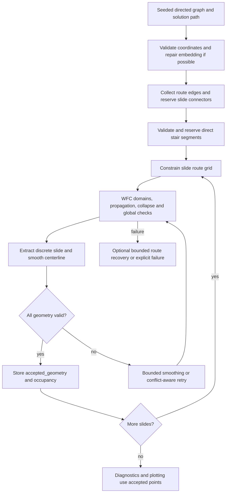

# Architecture and developer guide

## Dependency map and responsibilities

```text
visualize_building.py -----> route_diagnostics
          |                       |
          +----> wfc_building ----+---> graph (NetworkX, NumPy, Matplotlib)
                      |           +---> wfc_solver ---> wfc_global ---> wfc_tiles
                      +----------------------------------------------> wfc_tiles
examples/wfc_building_example.py ----> wfc_building, route_diagnostics
examples/route_robustness_experiment.py --> wfc_building, route_diagnostics
examples/export_building_json.py --> json_export --> wfc_building, route_diagnostics
building_generation --> wfc_building, route_diagnostics
blender/import_building.py --> exported JSON and Blender bpy
tests/ --> active modules and benchmark example
archive/legacy_graph_wfc/ --> active graph and WFC modules
```

`wfc_building` uses local imports from diagnostics for geometric helpers and
optional diagnostic plotting; diagnostics uses protocols for its building
interface and locally imports `RouteGenerationError` during validation. The
archive is historical but not standalone. This diagram omits standard-library
imports.

| File | Responsibility |
| --- | --- |
| [`src/graph.py`](../src/graph.py) | `Building`: bounded graph regeneration, randomized recursive solution-path search, population, reachability/dead-end validation and repair, directional edge types and graph plot. |
| [`src/wfc_tiles.py`](../src/wfc_tiles.py) | `Tile`, `Direction`, `PortKind`, face compatibility and local domain propagation. |
| [`src/wfc_global.py`](../src/wfc_global.py) | Completed-layout checks and domain reachability pruning, including typed/directed routes. |
| [`src/wfc_solver.py`](../src/wfc_solver.py) | `solve_wfc`, seeded collapse and restarts, optional heuristics and detailed contradiction information. |
| [`src/wfc_building.py`](../src/wfc_building.py) | `WFCBuilding`, `WFCPath`, graph embedding repair, direct stairs, slide routing, reservations, accepted geometry, recovery and plots. |
| [`src/building_generation.py`](../src/building_generation.py) | Optional whole-building retry factory, deterministic candidate seeds and per-attempt diagnostics. |
| [`src/route_diagnostics.py`](../src/route_diagnostics.py) | `diagnose_routes`, route/pair reports and advisory thresholds. |
| [`src/json_export.py`](../src/json_export.py) | Validate and serialize the graph and exact accepted route geometry as versioned JSON. |
| [`examples/export_building_json.py`](../examples/export_building_json.py) | Seeded JSON export command. |
| [`blender/import_building.py`](../blender/import_building.py) | Blender-only import of route curves and floor outlines. |
| [`visualize_building.py`](../visualize_building.py) | Interactive two-panel display and explicit diagnostic failure handling. |
| [`examples/wfc_building_example.py`](../examples/wfc_building_example.py) | A separate demonstration, diagnostic overlay and optional saved figure. |
| [`examples/route_robustness_experiment.py`](../examples/route_robustness_experiment.py) | Benchmarks, comparison modes, summaries, CSV and plot output. |
| [`tests/`](../tests/) | Unit/integration tests for tiles, global checks, solver, building, diagnostics, experiment and the separate Castle playground. |
| [`archive/legacy_graph_wfc/`](../archive/legacy_graph_wfc/) | Older direct graph-to-tile prototype and the previous graph generator (`src/legacy_building.py`), used by historical seeded regression fixtures. |
| [`graph.py`](../graph.py) | Historical root-level graph implementation; the active generator imports `src.graph` instead. |
| [`escape_room_todo.md`](../escape_room_todo.md) | Project goals and proposed work, some of which is not yet implemented. |

Benchmark CSVs and images may be generated locally; they are not included in
the repository. Historical results need not describe the current behavior.

## Generation algorithm

```text
seed NumPy temporarily; try bounded directed graph candidates:
    find a start-to-exit path; populate edges; validate reachability
    repair dead ends and revalidate; reject an invalid candidate
restore caller's NumPy random state
validate coordinates and forbidden cells
if a stair is near an unrelated route endpoint:
    try bounded whole-floor rotations/reflections on the affected interior floor
    keep a transformed graph only if all such conflicts clear
enumerate graph stair and slide edges in deterministic routing order
reserve slide endpoint connectors
validate and reserve each direct stair from graph source to target
for each slide:
    build route grid/domains from endpoints, occupancy, connectors and obstacles
    attempt seeded WFC candidate within the existing attempt budget
    extract a connected, directed discrete route
    smooth XY; assign descending height using horizontal arc length
    validate geometry and previous accepted routes
    if stair collision: queue bounded route-specific cell exclusions;
        avoid re-smoothing previously rejected cell signatures
    if necessary, try lower smoothing strengths and local endpoint anchoring
    if needed and enabled, reopen a bounded selection of previous slide routes
    accept exact validated points or report failure
return graph, solution path, route records and diagnostics
```

Graph search uses recursive backtracking to find its solution path. Up to
`max_graph_attempts` candidates (default 100) are tried; exhaustion raises
`GraphGenerationError`. Non-wall nodes must be reachable from the start.
The `dead_end` flag is refreshed after graph updates and before validation:
a non-wall node other than the exit is flagged if it has at most one distinct
neighbor (ignoring direction) or no outgoing edges. Population also uses this
flag to decide whether a non-connector node may start an inter-floor edge, so
refreshing it can change the generated topology compared with the upstream
generator's original flag bookkeeping. When dead ends are disallowed, flagged
leaves and directed sinks must have a route to the exit. This deliberately does not require all nodes in
reachable non-dead-end cycles to reach the exit. Graph node and edge labels
use `type`; the WFC adapter also understands the previous `kind` edge label.
The attempt limit bounds the number of candidates, not the time spent in the
recursive search for one candidate. The separate opt-in
`generate_building(max_building_retries=N, ...)` factory creates at most N+1
complete independent candidates when routing or final geometry validation
rejects them for geometric reasons. Graph-generation exhaustion and unexpected
or non-geometric errors propagate without retry. Each candidate gets a fresh
building and retains the graph generator's independent `max_graph_attempts`
limit. Attempt zero uses the requested seed; later candidate seeds use
`(seed + index * 0x9E3779B9) % 2**32` for both graph and WFC. The factory
returns the accepted building and structured per-candidate stage, seed, error,
WFC-attempt and timing records; exhaustion raises `BuildingRegenerationError`
with those records. It does not retry advisory warnings. Direct constructor
use remains unchanged. WFC uses seeded restarts
after contradictions, not a general in-place
decision-stack backtracker. Route-level recovery can regenerate a bounded
window of previously accepted slides; it is a separate mechanism. Fixed
stairs are not reopened. The construction sequence also handles reservations
and consistency checks; see `generate_routes`, `_generate_route`,
`_smooth_route_candidate` and `_recover_routes` for the precise ordering.



## Constraints and routing

Graph nodes are `(x, y, floor)`; WFC cells are
`(floor_step, x_step, y_step)`. `graph_node_to_cell` maps endpoints exactly.
Graph edge kinds select straight ascending stairs or descending WFC slides.
Slide endpoint directions, forbidden cells, previously occupied route cells
and reserved connectors constrain each route's tile domains. Direct stairs
are continuous obstacles rather than zigzag WFC paths.

Tiles have six typed faces (`none`, `walk`, `stair`, `slide`). Neighboring
faces must match. Propagation removes unsupported domain values. The solver
chooses unresolved cells using minimum remaining values, with the optional
source-frontier, tile-aware reachability and candidate-lookahead heuristics.
Reachability pruning operates on a conservative possible-route graph; the
completed layout is checked for matching ports, boundaries, required links
and directed typed endpoint connectivity. This is distinct from later
continuous-geometry validation.

Slide smoothing tries strengths 1.0, 0.75 and 0.5. A constrained local height
anchor can be attempted near an endpoint. The original source and target,
descending direction, horizontal travel, grade, turning radius and sampled
curvature checks remain enforced. The accepted sampled polyline is retained
in `WFCPath.accepted_geometry` along with the relevant smoothing metadata.
`validate_accepted_geometry` rechecks it; plotting uses it directly.

## Collision validation and diagnostics

Direct stairs are checked as continuous segments against unrelated route
endpoints, other stairs, slide centerlines, occupied/forbidden cells and
reserved slide connectors. Slide candidates are checked against existing
routes and obstacles; previously accepted geometry is revalidated against a
new candidate too. Legitimate shared graph endpoints and explicitly
compatible shared landing connectors have specific exceptions, not general
permission for overlapping segments. The existing cell/connector clearance
uses `0.2 / grid_resolution` in graph units; route intersections and other
geometry rules are separate checks. Do not equate these centerline checks
with swept-volume mesh collision certification.

`diagnose_routes` reports endpoint, continuity, direction and geometry
revalidation failures as logical errors. Slope, turn angle, curvature and
pairwise approach thresholds can produce advisory warnings. In particular,
the default diagnostic pair-clearance threshold of `0.25` graph units is
not the hard routing clearance. A warning does not modify or reject a route.

## Recovery and failure modes

- Bounded graph generation can fail before routing. Historical seed 7 failures
  came from the previous generator and do not necessarily reproduce with the
  current one. Graph regeneration exhaustion is not a WFC failure or proof
  that no graph exists.
- In the previous graph generator, seed 11 placed a stair through an unrelated slide endpoint.
  A bounded interior-floor embedding transform can repair that conflict while
  preserving topology; it may change graph coordinates. If no tested
  transform works, normal direct-stair validation still rejects a collision.
- In the previous graph generator, seed 13 produced repeated slide candidates colliding with a
  fixed stair. The router can try up to four temporary, route-specific
  empty-cell exclusions derived from the collision and skips repeated
  rejected signatures. These retries preserve the attempt budget and final
  validation.
- The new graph generator may produce direct stairs intersecting another stair
  or a slide connector. These graphs fail explicit geometric validation;
  graph reachability does not imply geometric feasibility.
- `none`, `recency` and `conflict-aware` are route-recovery settings.
  Conflict-aware recovery uses free-space reachability to rank sets of
  blockers, then still invokes WFC; it can fall back to recency. A failed
  bounded search proves only that no solution was found in that search.
- The default constructor uses recency recovery; the interactive
  visualization explicitly chooses `none`. Different options or resolution
  can therefore produce different outcomes, even at the same seed.

## Extending safely and reproducibly

Run active and archived tests as documented in the [README](../README.md).
Compare graph nodes/attributes, ordered directed edges, solution path, full
route records and accepted sampled geometry, plus diagnostic outcomes—not
just success counts—when asserting that an organizational change is
behavior-neutral. Preserve the seed, dimensions, resolution, recovery and
heuristic settings and dependency versions. The graph temporarily seeds and
restores NumPy's global state; solver attempts use seeded local randomness.
Iteration order, dependency versions, route ordering, smoothing or heuristic
changes can change deterministic results. Keep hard collision checks and
advisory diagnostic thresholds distinct, and add tests for any intentional
behavior change.

For future Blender work, use the [handoff guide](../BLENDER_INTEGRATION.md).
The JSON exporter and Blender curve importer are implemented; production
building meshes and gameplay are not.
